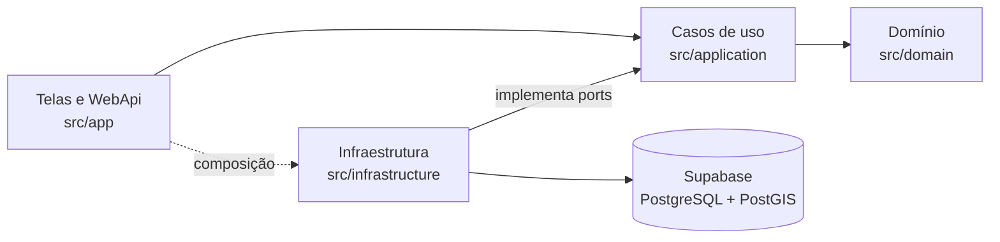

# E-Farmácia

Plataforma web para quem precisa comprar um medicamento: pesquise pelo nome ou princípio ativo, leia a bula organizada, compare preços entre farmácias (incluindo genéricos e similares), encontre farmácias perto de você e use cupons de desconto.

> O E-Farmácia informa, não substitui a orientação de médico ou farmacêutico.
> Farmácias, preços e cupons exibidos são **dados de demonstração**.

## Sobre o produto

Comprar um remédio costuma exigir várias buscas: a bula está num lugar, o preço em outro e a farmácia mais próxima em um terceiro. O E-Farmácia reúne tudo numa única página por medicamento, destaca alternativas mais baratas com o mesmo princípio ativo e mostra quando cada preço foi atualizado.

Público-alvo: qualquer pessoa que compra medicamentos, com foco no uso pelo celular. Um painel administrativo permite à equipe manter o catálogo, os preços, as farmácias e os cupons.

Projeto Integrador I — Senac.

## Funcionalidades

- Busca por nome comercial ou princípio ativo, sem diferenciar acentos e maiúsculas, com filtro por categoria.
- Página do medicamento com bula organizada em seções e link para o Bulário Eletrônico da Anvisa.
- Preços por farmácia com data de atualização e selo "Desatualizado" para preços com mais de 7 dias.
- Alternativas com o mesmo princípio ativo (referência, genérico e similar).
- Mapa de farmácias próximas (OpenStreetMap) com busca por nome ou bairro; sem permissão de localização, usa a Av. Paulista como referência.
- Cupons das farmácias parceiras com QR code para mostrar no caixa, rota até a farmácia e opção de copiar o código.
- Cadastro e login por e-mail e senha.
- "Reportar preço incorreto" para usuários logados.
- Painel administrativo com indicadores e gestão de medicamentos e bulas, preços, farmácias, cupons, categorias e reportes.

## Demonstração

https://senac-e-farmacia.vercel.app

## Tecnologias

| Camada | Tecnologias |
| --- | --- |
| Interface | Next.js 16 (App Router), React 19, TypeScript, Tailwind CSS 4, lucide-react |
| Mapa | Leaflet, react-leaflet, OpenStreetMap, Nominatim (nome da cidade) |
| Cupons | qrcode.react |
| Dados e autenticação | Supabase (PostgreSQL, PostGIS, Auth, Row Level Security) |
| Testes | Vitest |
| Hospedagem | Vercel |

## Arquitetura

Clean Architecture orientada a domínio, num único projeto Next.js. As dependências apontam sempre para dentro: o domínio não conhece ninguém, a aplicação conhece só o domínio e as interfaces (ports), e a infraestrutura implementa essas interfaces.



Princípios SOLID aplicados:

- **Responsabilidade única:** um repositório por agregado, casos de uso pequenos e componentes do painel separados entre tela, campo de formulário e cliente da API.
- **Aberto/fechado:** as telas do painel são guiadas por configuração (`src/components/admin/entities.ts`); uma nova entidade entra sem alterar o componente.
- **Substituição de Liskov:** os testes trocam os repositórios Supabase por repositórios em memória que cumprem o mesmo contrato.
- **Segregação de interfaces:** cada caso de uso recebe só os repositórios de que precisa (`Pick<Repositories, ...>`).
- **Inversão de dependência:** casos de uso e ações de login dependem de interfaces (`Repositories`, `AuthService`); as implementações são montadas na raiz de composição (`src/infrastructure/container.ts`).

## Estrutura de pastas

```
src/domain/            Entidades e regras de negócio puras (preço, cupom, farmácia, medicamento...)
src/application/       Casos de uso (use-cases/) e interfaces de repositório e autenticação (ports.ts)
src/infrastructure/    Repositórios Supabase, mapeadores, autenticação e raiz de composição
src/app/api/           WebApi: controllers REST (Route Handlers)
src/app/               Páginas (App Router), ações de servidor, telas de carregamento e erro
src/components/        Componentes de interface (inclui admin/)
src/lib/               Utilitários de formatação, destinos seguros e localização
tests/unit/            Testes de domínio, casos de uso e utilitários
tests/integration/     Testes da WebApi e dos repositórios contra o banco
supabase/migrations/   Esquema, RLS, funções de busca e dados de demonstração
supabase/scripts/      Renovação das datas dos dados de demonstração
supabase/tests/        Verificações SQL de busca, mapa e permissões
scripts/               Configuração da autenticação, criação do admin e verificação de ponta a ponta
public/                Ícones e ilustrações (embalagens dos medicamentos)
```

## Pré-requisitos

- Node.js 20.9 ou superior e npm.
- Um projeto no Supabase (o plano gratuito atende).

## Instalação e execução

```bash
git clone https://github.com/otavioaugustoreis/senac-e-farmacia-webapi.git
cd senac-e-farmacia-webapi
npm install
cp .env.example .env.local        # preencha com os dados do seu projeto Supabase
npx supabase link --project-ref <ref-do-projeto>
npx supabase db push --remote     # cria tabelas, regras de acesso e dados de demonstração
npm run dev                       # http://localhost:3000
```

Para criar o usuário administrador (o script imprime a senha gerada):

```bash
node --env-file=.env.local scripts/configure-auth.mjs http://localhost:3000
node --env-file=.env.local scripts/create-admin.mjs admin@exemplo.com
```

Antes de uma apresentação, renove as datas dos dados de demonstração:

```bash
npx supabase db query --remote -f supabase/scripts/refresh-demo-data.sql
```

## Variáveis de ambiente

Ficam em `.env.local`, que nunca é versionado. O arquivo `.env.example` lista os nomes.

| Variável | Descrição | Obrigatória | Exemplo fictício |
| --- | --- | --- | --- |
| `NEXT_PUBLIC_SUPABASE_URL` | URL do projeto Supabase | Sim | `https://abcdefgh.supabase.co` |
| `NEXT_PUBLIC_SUPABASE_ANON_KEY` | Chave pública (publishable) do projeto | Sim | `sb_publishable_xxxx` |
| `SUPABASE_PROJECT_REF` | Identificador do projeto, usado por `configure-auth.mjs` | Só para os scripts | `abcdefgh` |
| `SUPABASE_ACCESS_TOKEN` | Token pessoal do Supabase, usado por `configure-auth.mjs` | Só para os scripts | `sbp_xxxx` |
| `SUPABASE_DB_PASSWORD` | Senha do banco, usada pela CLI do Supabase | Só para a CLI | `senha-do-banco` |
| `SUPABASE_SERVICE_ROLE_KEY` | Chave secreta para scripts administrativos; nunca vai ao navegador | Só para os scripts | `sb_secret_xxxx` |
| `ADMIN_EMAIL`, `ADMIN_PASSWORD` | Credenciais do admin para a parte administrativa de `verify-flows.mjs` | Não | `admin@exemplo.com` |

## Scripts disponíveis

| Comando | O que faz |
| --- | --- |
| `npm run dev` | Servidor de desenvolvimento em `http://localhost:3000` |
| `npm run build` | Build de produção |
| `npm run start` | Sobe o build de produção |
| `npm run lint` | ESLint |
| `npm test` | Testes unitários e de integração (Vitest) |
| `node --env-file=.env.local scripts/configure-auth.mjs <url-do-site>` | Configura a autenticação do Supabase e grava a chave secreta no `.env.local` |
| `node --env-file=.env.local scripts/create-admin.mjs <email>` | Cria ou redefine o usuário administrador |
| `node --env-file=.env.local scripts/verify-flows.mjs <url-do-site>` | Verificação de ponta a ponta (cadastro, reporte, permissões e admin) |

## Testes

```bash
npm test         # 110 testes no padrão AAA (Arrange, Act, Assert)
npm run lint
npx tsc --noEmit
```

Os testes de integração leem o banco de verdade como visitante anônimo e são pulados se `.env.local` não estiver configurado. A verificação de ponta a ponta usa um servidor rodando:

```bash
ADMIN_EMAIL=admin@exemplo.com ADMIN_PASSWORD=... node --env-file=.env.local scripts/verify-flows.mjs http://localhost:3000
```

## API

| Método | Rota | Descrição |
| --- | --- | --- |
| GET | `/api/medicamentos?q=&categoria=` | Busca de medicamentos |
| GET | `/api/medicamentos/:id` | Detalhe com bula, preços, alternativas e cupons |
| GET | `/api/categorias` | Categorias |
| GET | `/api/farmacias/proximas?lat=&lng=` | Farmácias num raio de 15 km (amplia se não houver) |
| GET | `/api/cupons` | Cupons vigentes |
| POST | `/api/reportes` | Reportar preço incorreto (exige login) |
| GET, POST | `/api/admin/:entity` | Listar; criar ou atualizar (somente admin) |
| GET, DELETE | `/api/admin/:entity/:id` | Detalhe; excluir (somente admin) |
| PATCH | `/api/admin/reportes/:id` | Marcar reporte como resolvido (somente admin) |

`:entity` é um de `medicamentos`, `precos`, `farmacias`, `cupons`, `categorias` ou `reportes`. Erros respondem `{ "errorMessage": "..." }` com 400 (validação), 401 (sem login), 403 (sem permissão) ou 404.

## Deploy

O repositório está conectado à Vercel: cada push na branch `main` publica o site, e cada Pull Request gera uma prévia. As variáveis `NEXT_PUBLIC_SUPABASE_URL` e `NEXT_PUBLIC_SUPABASE_ANON_KEY` ficam configuradas no projeto da Vercel.

## Segurança

- Row Level Security em todas as tabelas: visitantes só leem o catálogo, cada usuário só cria os próprios reportes e apenas administradores alteram dados. O papel de administrador vem de uma tabela que o usuário não consegue editar.
- A WebApi valida a sessão no servidor e responde 401 ou 403; consultas ao banco usam parâmetros, nunca texto montado.
- Cabeçalhos de segurança (CSP `frame-ancestors`, HSTS, `nosniff`, `Referrer-Policy`, `Permissions-Policy`) e redirecionamento pós-login restrito ao próprio site.
- Segredos ficam apenas em variáveis de ambiente; a chave secreta do Supabase nunca é enviada ao navegador.

Encontrou uma vulnerabilidade? Abra uma issue no GitHub sem detalhes de exploração e peça um contato privado à equipe.

## Autores

Felipe Anderson Anacleto da Silva, João Paulo Vieira Henrique Rampcke Lopes, Pedro Augusto Ferreira Guimarães, Pablo Rosa de Jesus, Alex Santana da Rocha, Otavio Augusto Reis Almeida e Gilvan Oliveira Ramos.
